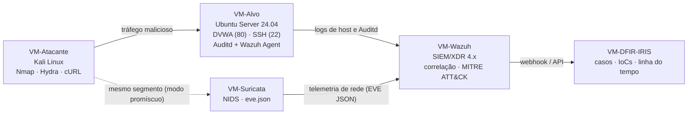

# Pipeline integrado de detecção, telemetria de rede e resposta a incidentes

**Suricata + Auditd + Wazuh + DFIR-IRIS em um laboratório virtualizado**

Trabalho de Conclusão de Curso (Engenharia da Computação, UNIFAN – Centro Universitário Nobre, Feira de Santana – BA).
Autor: Felipe Henriques Batista do Nascimento · Orientador: Darlan Batista Oliveira

> **Status do projeto:** o artigo do TCC descreve a arquitetura, o protocolo experimental e a matriz de testes.
> As seções marcadas com **[PREENCHER]** abaixo esperam os números medidos no seu laboratório. Não deixe nenhuma
> delas vazia ou com valor inventado antes de publicar o repositório.

## Summary

This project implements and evaluates an integrated open-source detection and response pipeline in an isolated VirtualBox lab.
Suricata (NIDS, EVE JSON telemetry) and Auditd (host kernel auditing, via the Wazuh agent) feed a Wazuh SIEM that decodes and correlates
events and maps them to MITRE ATT&CK. Wazuh forwards qualified alerts to DFIR-IRIS for case management and triage.
The pipeline is tested with controlled attacks from Kali Linux (Nmap reconnaissance, Hydra brute force against SSH and web login,
and command/SQL injection with cURL against DVWA) and evaluated with Precision, Recall, F1-score, alert latency,
Suricata packet drop rate and host resource usage.

## Pergunta de pesquisa

> Qual a capacidade de detecção, visibilidade de rede e custo computacional de um pipeline que integra a telemetria do Suricata,
> o monitoramento de host com Auditd/Wazuh e a gestão de incidentes no DFIR-IRIS, em laboratório virtualizado,
> frente a ataques de Reconhecimento, Força Bruta e Exploração Web?

## O que este projeto demonstra

- Montagem de um mini-SOC com ferramentas de código aberto: NIDS, auditoria de host, SIEM e plataforma de resposta a incidentes.
- Integração entre camadas: telemetria de rede (Suricata `eve.json`), telemetria de kernel (Auditd) e correlação centralizada (Wazuh).
- Abertura de casos investigativos no DFIR-IRIS a partir de alertas do Wazuh (webhook/API).
- Simulação controlada de ataques (visão Red Team) e avaliação das detecções (visão Blue Team), ou seja, uma abordagem **Purple Team**.
- Avaliação com método: protocolo de verdade de referência (*ground truth*), Precisão, Revocação e F1-score, em vez de apenas contar alertas.

## Arquitetura



O Suricata fica em uma VM própria com a interface em **modo promíscuo** (VirtualBox: "Permitir Tudo"),
na mesma Rede Interna do atacante e do alvo, para inspecionar todo o tráfego entre as duas máquinas.

### Ambiente virtualizado (Oracle VM VirtualBox, Rede Interna isolada)

| Máquina virtual | Sistema / versão | RAM | CPU | Disco | Função |
|---|---|---|---|---|---|
| VM-Alvo | Ubuntu Server 24.04 LTS | 2 GB | 2 vCPU | 20 GB | Apache + DVWA (porta 80), SSH (porta 22), Wazuh Agent e Auditd |
| VM-Atacante | Kali Linux 2024.x | 2 GB | 2 vCPU | 20 GB | Origem dos ataques: Nmap, Hydra, cURL |
| VM-Suricata | Ubuntu Server 24.04 LTS / Suricata 7.x | 2 GB | 2 vCPU | 20 GB | NIDS em modo promíscuo, exporta `eve.json` |
| VM-Wazuh | Ubuntu Server 24.04 LTS / Wazuh 4.x | 8 GB | 4 vCPU | 40 GB | SIEM: decoders, correlação, MITRE ATT&CK, envio ao DFIR-IRIS |
| VM-DFIR-IRIS | Ubuntu Server 24.04 LTS / DFIR-IRIS | 4 GB | 2 vCPU | 30 GB | Casos, IoCs e triagem do analista |

Total do laboratório: 18 GB de RAM, 12 vCPU e 130 GB de disco.

## Cenários de teste

Cada cenário malicioso é repetido **5 vezes**; o resultado reporta média e desvio padrão.
Cada execução é registrada em planilha de controle (ID do teste, início e fim, tipo de ataque, IP de origem).

| Cenário | Vetor / ferramenta | Alvo | Repetições | Detecção esperada |
|---|---|---|---|---|
| Reconhecimento | Scan SYN e detecção de versões (`nmap -sS -sV`) | VM-Alvo | 5 | Suricata (scan e anomalias de conexão) e Wazuh |
| Força bruta SSH | `hydra ssh` | VM-Alvo (22) | 5 | Suricata (telemetria de rede) e Wazuh/Auditd (falhas de autenticação) |
| Força bruta HTTP | `hydra http-post-form` | DVWA (80) | 5 | Suricata (múltiplos POST) e Wazuh (logs web) |
| Exploração web e injeção de comandos | SQL Injection e Command Injection com `curl` | DVWA (80) | 5 | Suricata (assinaturas HTTP), Wazuh (logs web) e Auditd (execução anômala de binários, p. ex. pelo usuário `www-data`) |
| Linha de base | Navegação e acesso SSH legítimos | VM-Alvo | 1 período | Nenhum alerta malicioso (mede ruído e falsos positivos) |

### Mapeamento MITRE ATT&CK (sugestão)

Confira com os alertas reais gerados no seu Wazuh antes de publicar.

| Cenário | Tática | Técnica sugerida |
|---|---|---|
| Reconhecimento | Discovery | T1046 – Network Service Discovery |
| Força bruta SSH / HTTP | Credential Access | T1110 – Brute Force |
| Exploração web | Initial Access | T1190 – Exploit Public-Facing Application |
| Injeção de comandos | Execution | T1059 – Command and Scripting Interpreter |

## Metodologia de avaliação

Os eventos são classificados contra o *ground truth* (Milenkoski et al., 2015):

- **VP (verdadeiro positivo):** alerta correto durante a execução de um ataque.
- **FP (falso positivo):** alerta sem atividade maliciosa.
- **FN (falso negativo):** ataque executado e não detectado.

```
Precisão  = VP / (VP + FP)
Revocação = VP / (VP + FN)
F1-score  = 2 × (Precisão × Revocação) / (Precisão + Revocação)
```

Medições adicionais:

- **Atribuição da detecção:** o que foi detectado pela camada de rede (Suricata) e o que foi detectado no host (Auditd/Wazuh Agent).
- **Latência de alerta:** tempo entre o disparo do ataque e o alerta aparecer no Wazuh Dashboard.
- **Taxa de descarte de pacotes:** extraída do `stats.log` do Suricata, para verificar perdas causadas pela virtualização.
- **Consumo de recursos** das VMs durante os testes.
- **Linha de base:** um período de tráfego legítimo para medir ruído e falsos positivos.

As regras do Suricata ficam no conjunto padrão **ET Open, sem *tuning***, para simular uma implantação inicial.

## Resultados

**[PREENCHER]** com os dados do seu experimento.

| Cenário | VP | FP | FN | Precisão | Revocação | F1 | Latência média (s) |
|---|---|---|---|---|---|---|---|
| Reconhecimento | [PREENCHER] | [PREENCHER] | [PREENCHER] | [PREENCHER] | [PREENCHER] | [PREENCHER] | [PREENCHER] |
| Força bruta SSH | [PREENCHER] | [PREENCHER] | [PREENCHER] | [PREENCHER] | [PREENCHER] | [PREENCHER] | [PREENCHER] |
| Força bruta HTTP | [PREENCHER] | [PREENCHER] | [PREENCHER] | [PREENCHER] | [PREENCHER] | [PREENCHER] | [PREENCHER] |
| Exploração web / injeção | [PREENCHER] | [PREENCHER] | [PREENCHER] | [PREENCHER] | [PREENCHER] | [PREENCHER] | [PREENCHER] |
| Linha de base | – | [PREENCHER] | – | – | – | – | – |

Também inclua aqui: taxa de descarte de pacotes do Suricata, consumo de CPU/RAM por VM e uma análise curta do que cada camada (rede e host) enxergou.

### Evidências (prints e vídeo)

**[PREENCHER]** com os arquivos que você tiver:

- Alerta do Suricata no Wazuh Dashboard (`docs/img/`)
- Alerta do Auditd correlacionado no Wazuh
- Caso aberto no DFIR-IRIS com IoCs e linha do tempo
- Vídeo curto de demonstração (ataque → alerta → caso): link aqui

## Como reproduzir (visão geral)

1. Crie uma **Rede Interna** no VirtualBox sem nenhuma ligação com redes externas.
2. Instale as 5 VMs conforme a tabela do ambiente. Na VM-Suricata, ative o modo promíscuo ("Permitir Tudo").
3. Na VM-Alvo, instale Apache + DVWA, ative o SSH, o Auditd e o Wazuh Agent.
4. Instale o Suricata na VM-Suricata (conjunto ET Open padrão) e envie o `eve.json` ao Wazuh.
5. Instale o Wazuh (Manager, Indexer e Dashboard) e configure a integração com o DFIR-IRIS via webhook/API.
6. Execute os cenários a partir da VM-Atacante, registrando cada teste na planilha de controle.
7. Classifique os alertas em VP, FP e FN e calcule as métricas.

Documentação oficial: [Suricata](https://docs.suricata.io/) · [Wazuh](https://documentation.wazuh.com/) · [DFIR-IRIS](https://docs.dfir-iris.org/) · [Auditd](https://github.com/linux-audit/audit-documentation) · [VirtualBox](https://www.virtualbox.org/manual/)

### Comandos de ataque usados nos testes (modelo)

Use apenas dentro do laboratório isolado. Substitua os valores entre `< >`.

```bash
# Reconhecimento
nmap -sS -sV <IP_ALVO>

# Força bruta SSH
hydra -L <usuarios.txt> -P <senhas.txt> ssh://<IP_ALVO>

# Força bruta no formulário de login do DVWA
hydra -L <usuarios.txt> -P <senhas.txt> <IP_ALVO> http-post-form "<caminho>:<campos>:<texto_de_falha>"
```

Para a exploração web, o artigo usa requisições `curl` com payloads de SQL Injection e Command Injection contra o DVWA.

## Estrutura sugerida do repositório

Crie as pastas conforme for adicionando o material (nada abaixo existe ainda):

```
.
├── README.md
├── docs/
│   ├── artigo-tcc.pdf          # artigo do TCC, se a faculdade liberar
│   └── img/                    # diagrama, prints do Wazuh e do DFIR-IRIS
├── configs/                    # suricata.yaml, ossec.conf, regras do Auditd (sem senhas nem tokens)
├── scenarios/                  # scripts e comandos de cada ataque
├── results/                    # planilha de controle, métricas, stats.log
└── LICENSE
```

## Limitações e ameaças à validade

- A virtualização limita o desempenho e pode causar descarte de pacotes nas interfaces virtuais.
- O tráfego é sintético, sem o volume nem a variabilidade de uma rede corporativa real.
- As regras do Suricata seguem o padrão ET Open, sem refinamento (*tuning*).
- O escopo é **somente IDS**: prevenção automática (IPS) e testes contra redes externas ou ambientes de produção estão fora do escopo.

## Trabalhos futuros

Este laboratório cobre a camada de tecnologia de detecção e triagem. Para se aproximar de um SOC completo, os próximos passos seriam:

- **Mais fontes de log:** firewall, DNS, proxy, Active Directory, estações Windows com EDR, nuvem e e-mail.
- **Resposta ativa:** evoluir do modo IDS para IPS e orquestrar ações automáticas com SOAR (por exemplo, Shuffle) a partir dos alertas do Wazuh.
- **Inteligência de ameaças:** enriquecer IoCs com serviços como o VirusTotal e feeds de inteligência, e praticar caça a ameaças (*threat hunting*).
- **Gestão de vulnerabilidades:** varredura contínua dos ativos e priorização dos achados.
- **Ajuste de regras (*tuning*):** reduzir falsos positivos e comparar o desempenho antes e depois do ajuste das regras ET Open.
- **Cenários mais realistas:** mais vetores de ataque, tráfego de fundo com maior volume e variabilidade, e comparação com outras ferramentas.
- **Processos de SOC:** playbooks de resposta, níveis de atendimento (N1, N2, N3), SLAs e métricas operacionais como MTTD e MTTR.

## Declaração ética

Todos os testes foram planejados para execução exclusiva em rede interna virtualizada e isolada, sem comunicação com redes externas
ou sistemas de terceiros. Não use os comandos deste repositório contra ambientes que você não tenha autorização para testar.

## Referências principais

- Scarfone, K.; Mell, P. (2007). *Guide to Intrusion Detection and Prevention Systems (IDPS)*. NIST SP 800-94.
- Milenkoski, A. et al. (2015). Evaluating computer intrusion detection systems: a survey of common practices. *ACM Computing Surveys*, 48(1).
- Albin, E.; Rowe, N. C. (2012). A realistic experimental comparison of the Suricata and Snort intrusion-detection systems. *IEEE WAINA*.
- Lisnevskyi, R. et al. (2026). Development of an integrated network threat detection system based on Wazuh, Suricata and Telegram Bot. *CEUR Workshop Proceedings*, v. 4180.
- WSCDC/SBSeg (2018) e WTICG/SBSeg (2021). Trabalhos nacionais sobre avaliação de IDS e uso do Suricata.

## Autor

**Felipe Henriques Batista do Nascimento**
Engenharia da Computação – UNIFAN · Feira de Santana, BA
LinkedIn: https://www.linkedin.com/in/felipehnasci/ · TryHackMe: https://tryhackme.com/p/Lipinnn

## Licença

Sugestão: MIT para os scripts e configurações, e CC BY 4.0 para a documentação. Escolha ao criar o repositório.
